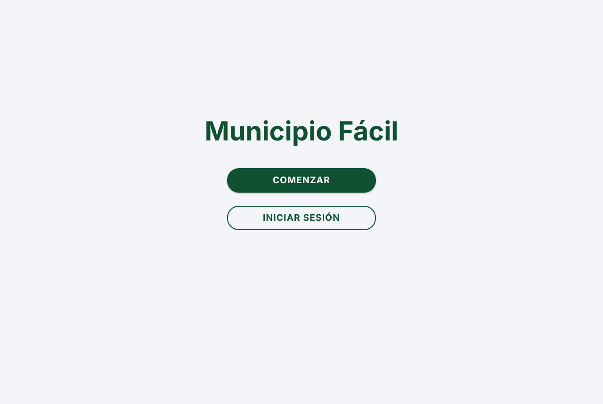
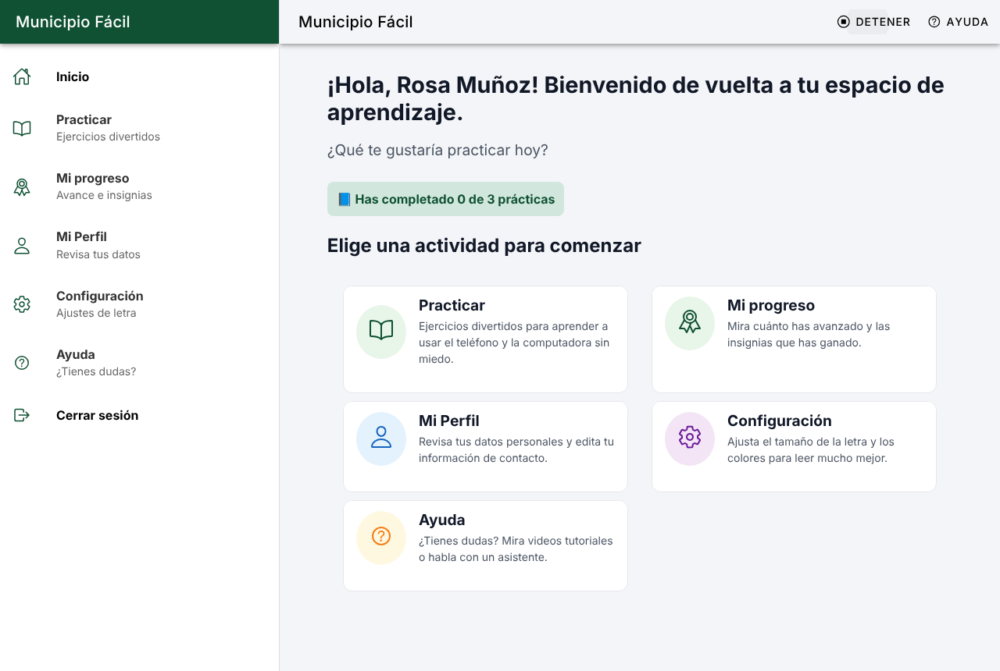
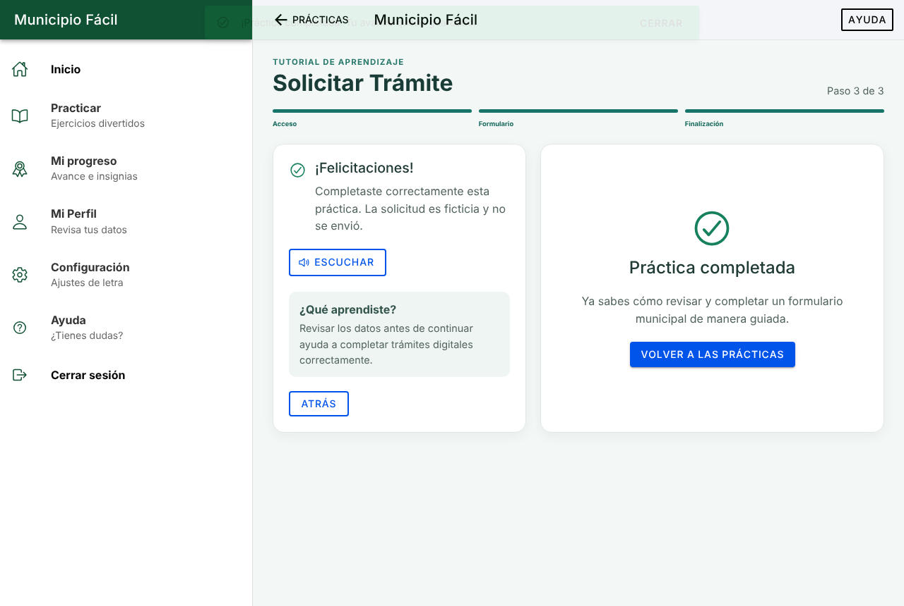
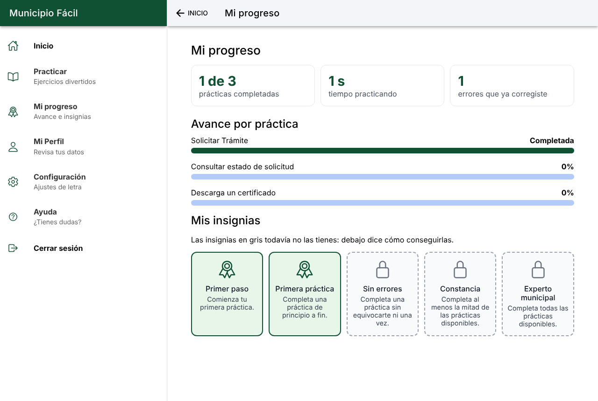
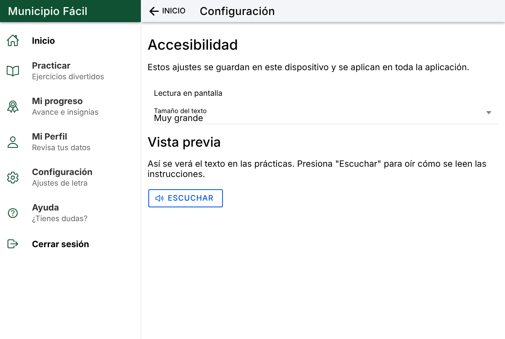
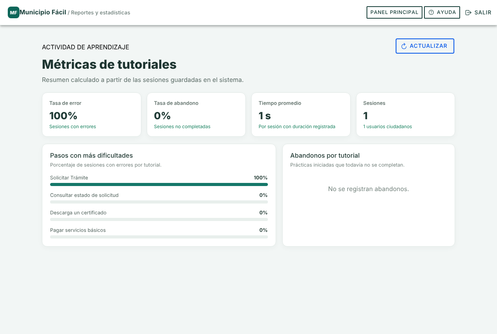
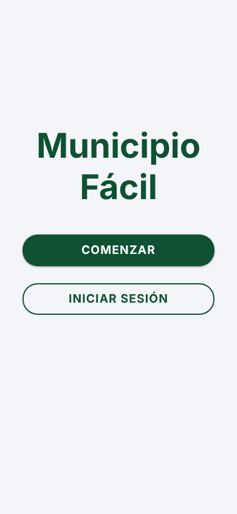
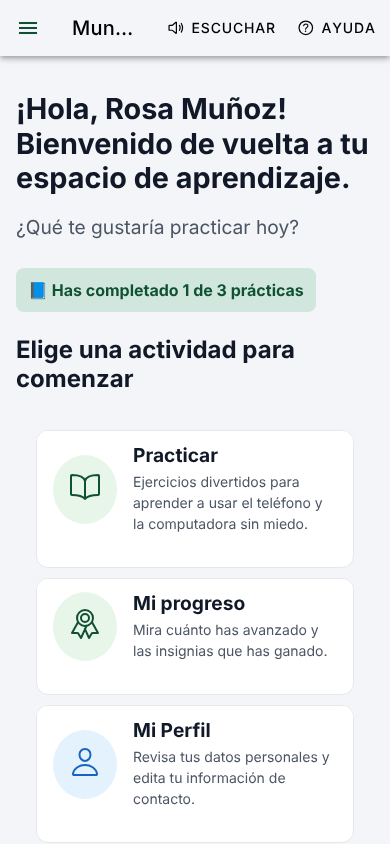
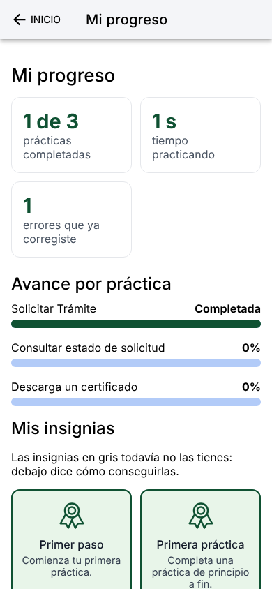

# App de Alfabetización Digital Ciudadana

## Integrantes del Equipo
* [Alexis Parra](https://github.com/AlexisEstebanParraS)
* [Fernando Pacheco](https://github.com/F3rsj)
* [Gabriel Díaz](https://github.com/Gabread)
* [Israel Pérez](https://github.com/Y63431)

---
## 1. Descripción General del Sistema

**Municipio Fácil** es una aplicación web y móvil para practicar trámites municipales en línea mediante simulaciones guiadas, sin riesgo de cometer errores reales.

### Objetivos

**Objetivo general:** mejorar la alfabetización digital de la ciudadanía, en especial de adultos mayores, para que realice trámites municipales en línea de forma autónoma.

**Objetivos específicos:**
* Ofrecer prácticas guiadas paso a paso de trámites municipales.
* Entregar retroalimentación clara ante cada error.
* Registrar el avance de cada ciudadano.
* Permitir al administrador gestionar módulos y usuarios y revisar métricas de aprendizaje.

### Funcionalidades Principales
* Registro e inicio de sesión de ciudadanos y administradores.
* Catálogo de prácticas y lecciones guiadas con validación en cada paso.
* Mi progreso, con barras de avance e insignias.
* Lectura en voz alta de las instrucciones.
* Ajuste del tamaño de letra.
* Mi Perfil.
* Gestión de módulos, usuarios y métricas (administrador).

### Tecnologías y Herramientas
* **Ionic** con **React** y **TypeScript**
* **React Router**
* **Vite** y **Vitest**
* **Docker** y **Nginx**
* **Figma**

---
## 2. Justificación del Problema y Usuarios Objetivo

### Contexto y Relevancia del Problema
A nivel comunal, el proceso de digitalización municipal ha trasladado trámites esenciales a plataformas en línea. No obstante, esto evidencia la brecha descrita en el **Problema 25: Baja Alfabetización Digital en la Población**, donde segmentos significativos (particularmente adultos mayores y ciudadanos con nula instrucción digital) carecen de las competencias prácticas para utilizar estos sistemas. Las consecuencias directas abarcan exclusión social, dependencia de intermediarios, retrasos en solicitudes críticas (como patentes, permisos o ayudas sociales) e incluso el retraso del proceso de digitalización para acomodar a este sector.

### Evidencia (fuentes secundarias)

1. La Ley 21.180 obliga a hacer los procedimientos administrativos por medios electrónicos, también en las municipalidades [1][2].
2. El 74,4 % de las personas de 60 años o más usa internet a diario, pero solo el 23,1 % hace trámites en línea (56 % entre 30 y 44 años) [3].
3. Solo el 42,9 % de las personas de 60 años o más sabe pagar en línea por sí misma y el 19,4 % sabe instalar una aplicación [3].
4. Entre los mayores de 80 años o con solo educación básica, no más del 5 % hace trámites por internet [4].

Conclusión: la principal barrera no es la conexión, sino la falta de práctica guiada.

#### Referencias

1. Ley N° 21.180, Transformación Digital del Estado. Diario Oficial, 11 de noviembre de 2019. https://www.diariooficial.interior.gob.cl/publicaciones/2019/11/11/42499/01/1680231.pdf
2. Ley N° 19.880, Bases de los Procedimientos Administrativos, artículo 2 (ámbito de aplicación). https://chile.justia.com/nacionales/leyes/ley-n-19-880/gdoc
3. SUBTEL y Cadem. *XII Encuesta de Acceso y Uso de Internet en Chile, medición 2025* (5.000 casos, terreno julio a septiembre de 2025). Tablas 13, 14 y 18. https://www.subtel.gob.cl/wp-content/uploads/2026/02/Informe-Final-Acceso-y-Uso-Internet-2025_03.pdf
4. Pontificia Universidad Católica de Chile y Caja Los Andes. *Sexta Encuesta Nacional de Calidad de Vida en la Vejez 2022*, capítulo 4: Acceso a las TICs. https://encuestacalidaddevidaenlavejez.uc.cl/wp-content/uploads/2023/08/Cap-4-Acceso-a-TICs-1-1.pdf

### Roles del sistema, accesibilidad y supuestos
La aplicación web deberá considerar dentro del sistema, al menos dos roles claramente diferenciados: el **ciudadano o usuario final**, quien interactúa con los módulos de simulación y aprendizaje, y el **funcionario o coordinador de capacitación**, encargado de diseñar y gestionar dichos módulos. El coordinador de capacitación también actuará como **administrador del sistema** para tareas de mantenimiento y configuración.

En cuanto a las necesidades de accesibilidad, seguridad y privacidad, la aplicación deberá ofrecer una interfaz con opciones para aumentar el tamaño del texto, hacer uso de un modo oscuro, activar la narración, activar las notificaciones y cambiar el idioma. También debe contar con protección adecuada de los datos personales ingresados durante las simulaciones de trámites.

#### Supuestos de la caracterización

No hubo contacto con usuarios reales. Los perfiles son una caracterización preliminar basada en las fuentes anteriores y en estos supuestos:

| Supuesto | En qué se apoya |
|---|---|
| La persona mayor tiene smartphone e internet, pero no experiencia en trámites en línea | Fuentes [3] y [4]: alto uso diario de internet y bajo uso para trámites |
| Su principal barrera es el miedo a equivocarse, más que la falta de equipo | Inferencia del equipo a partir de [3]: pocas personas mayores saben hacer pagos o instalar aplicaciones por sí mismas |
| Las personas con menos años de estudio y las mayores de 80 son las más rezagadas | Fuente [4] |
| El funcionario municipal puede diseñar y ajustar los módulos sin aprobación de sus superiores | Supuesto del equipo, sin fuente |

### Caracterización y Perfiles de Usuario (Proto-Personas)

#### Proto-Persona 1: Usuario Aprendiz
* **Tipo de usuario / rol:** Ciudadano - Adulto Mayor (Usuario final).
* **Características generales:** 68 años, jubilado, cuenta con un smartphone básico con conexión a internet móvil limitada.
* **Necesidades principales:** Aprender a solicitar horas médicas y certificados municipales sin depender de terceros.
* **Objetivos de uso:** Perder el temor a equivocarse y comprender la simbología de los formularios web.
* **Dificultades y puntos de frustración:** Letra pequeña, botones poco reconocibles, miedo a cometer errores irreversibles o sufrir fraudes, y términos técnicos complejos.
* **Funcionalidades que utilizaría:** Simulador de ingreso de formularios, tutorial con modo guiado por voz/audio y ejercicios de prueba paso a paso con reintentos infinitos.
* **Dispositivo y contexto:** Smartphone Android de gama de entrada, acceso desde el hogar con letra configurada en tamaño grande.

#### Proto-Persona 2: Coordinador de Capacitación
* **Tipo de usuario / rol:** Funcionario / Administrador del sistema.
* **Características generales:** 34 años, asistente social o funcionario del área de desarrollo comunitario de la municipalidad, nivel intermedio-alto de alfabetización digital.
* **Necesidades principales:** Diseñar simulaciones acordes a los trámites vigentes del municipio y evaluar qué pasos generan mayor dificultad en la población.
* **Objetivos de uso:** Disminuir la saturación de atención presencial capacitando virtualmente a los usuarios.
* **Dificultades y puntos de frustración:** Falta de herramientas didácticas para enseñar a personas mayores y baja disponibilidad de métricas claras de aprendizaje.
* **Funcionalidades que utilizaría:** Panel de gestión de módulos formativos, editor de preguntas/pasos de simulación y métricas de finalización.
* **Dispositivo y contexto:** Computador de escritorio o notebook municipal vía navegador web.

---

## 3. Requerimientos del Sistema

### Requerimientos Funcionales (RF)
* **RF01 - Catálogo de Trámites Simulados (Usuario):** El sistema debe listar los módulos interactivos de trámites municipales disponibles (ej. reserva de horas, solicitud de certificados, pago de aseo) con indicadores visuales de nivel de dificultad.
* **RF02 - Simulador Guiado de Formularios (Usuario):** El sistema guía al usuario paso a paso por un formulario de trámite simulado, valida cada campo antes de continuar y destaca el siguiente elemento con el que debe interactuar.
* **RF03 - Asistente de Lectura y Ayuda Contextual (Usuario):** El sistema lee en voz alta, al presionar "Escuchar", las instrucciones de cada paso de la práctica y las opciones de la pantalla de inicio, en español y a una velocidad pausada.
* **RF04 - Retroalimentación Inmediata de Errores (Usuario):** El sistema debe entregar mensajes de corrección claros y libres de tecnicismos cuando el usuario cometa una equivocación durante la simulación, permitiendo reintentos ilimitados.
* **RF05 - Historial y Progreso Formativo (Usuario):** El sistema registra el avance de cada práctica (paso, errores, tiempo y estado) y lo muestra en la pantalla "Mi progreso" con barras de avance e insignias.
* **RF06 - Crear Módulos de Capacitación (Admin):** El sistema permite al administrador crear un módulo de práctica con título, descripción, dificultad, cantidad de pasos y estado inicial.
* **RF07 - Modificar Módulos de Capacitación (Admin):** El sistema permite al administrador modificar los datos de un módulo existente.
* **RF08 - Habilitar o Deshabilitar Módulos (Admin):** El sistema permite al administrador ocultar un módulo a la ciudadanía (deshabilitarlo) o volver a mostrarlo, sin perder el progreso registrado.
* **RF09 - Métricas de Errores y Usabilidad (Admin):** El sistema genera reportes agregados que indican qué pasos de los simuladores presentan la mayor tasa de fallos o abandono.
* **RF10 - Gestión de Cuentas (Admin):** El sistema permite al administrador desactivar o reactivar la cuenta de un ciudadano; una cuenta desactivada no puede iniciar sesión.

### Requerimientos No Funcionales (RNF)
* **RNF01 - Usabilidad y Accesibilidad:** La interfaz debe cumplir con criterios de contraste accesible (WCAG AA), tipografía escalable con un tamaño base no inferior a 16px y áreas táctiles de botones de al menos 48x48px.
* **RNF02 - Rendimiento:** Las vistas y recursos iniciales deben cargar en un tiempo inferior a 2.5 segundos bajo redes móviles estándar (3G/4G).
* **RNF03 - Diseño Adaptable (Responsividad):** La interfaz debe ajustarse sin pérdida de consistencia funcional entre pantallas móviles (desde 360px de ancho) y navegadores web de escritorio.
* **RNF04 - Seguridad y Privacidad de Datos:** Los datos escritos en las prácticas no salen del navegador; la lección envía solo paso, errores, tiempo y completado. Contraseñas con bcrypt (costo 10), sesión de máximo 2 horas y respuesta 429 tras 10 intentos de inicio de sesión en 15 minutos.
* **RNF05 - Compatibilidad Multiplataforma:** La aplicación funciona en las versiones vigentes de Chrome, Edge, Firefox y Safari, en pantallas desde 360 px hasta 1920 px de ancho sin desplazamiento horizontal, y puede empaquetarse como app Android/iOS con Capacitor.

---

## 4. Instrucciones de Instalación y Ejecución

### Prerrequisitos
* **Node.js**: Versión 18 o superior LTS instalada (descargar desde [nodejs.org](https://nodejs.org/)).
* **Git**: Instalado en el sistema para la gestión del repositorio.

### Pasos para clonar y ejecutar el frontend

1. **Clonar el repositorio y entrar al proyecto:**
   ```bash
   git clone https://github.com/Y63431/Alfabetizacion-Web.git
   cd Alfabetizacion-Web
   ```

2. **Situarse en la rama frontend**
   ```bash
   git checkout frontend
   ```

3. **Instalar dependencias**
   ```bash
   npm install
   ```

4. **Configurar la URL de la API**
   ```bash
   cp .env.example .env
   ```

   | Variable | Descripción | Ejemplo |
   |---|---|---|
   | `VITE_API_URL` | URL base de la API del backend | `http://localhost:3000/api` |

5. **Ejecutar servidor local** (con el backend en ejecución)
   ```bash
   npm run dev
   ```

6. **Abrir en navegador**
* Abrir navegador en `http://localhost:5173/`
* Utilizar aplicación

7. **Pruebas**
   ```bash
   npx vitest run
   npm run lint
   ```

### Integración con la API

Las llamadas protegidas pasan por `src/services/api.ts`, que agrega el JWT y cierra la sesión ante un `401`.

| Pantalla | Endpoints | Rol |
|---|---|---|
| Registro / Login | `POST /auth/registro`, `POST /auth/login` | Público |
| Inicio | `GET /modulos`, `GET /progreso` | Ciudadano |
| Practicar | `GET /modulos`, `GET /progreso` | Ciudadano |
| Lección | `GET /modulos/:id`, `POST /progreso`, `PATCH /progreso/:id` | Ciudadano |
| Mi progreso | `GET /modulos`, `GET /progreso` | Ciudadano |
| Mi Perfil | `GET /usuarios/me`, `PUT /usuarios/me` | Ciudadano |
| Usuarios (admin) | `GET /admin/usuarios`, `PATCH /admin/usuarios/:id` | Admin |
| Métricas (admin) | `GET /admin/metricas` | Admin |
| Módulos (admin) | `GET`, `POST`, `PUT`, `PATCH`, `DELETE /modulos` | Admin |

### Docker

```bash
docker build -t municipio-facil-web .
docker run --rm -p 127.0.0.1:8080:80 municipio-facil-web
```

La app queda en `http://localhost:8080`.

## 5. Prototipo en Figma
Prototipo de las versiones móvil y web, elaborado de forma manual con las herramientas convencionales de Figma, sin asistentes de IA.

Link a Mockups [Figma](https://www.figma.com/design/u9nffOZTdsYh1RBRvRnf2z/Alfabetizacion-Web?m=auto&t=Ux02yCFqAIKCVX0t-1)

## 6. Arquitectura de Navegación y Experiencia del Usuario


### a) Rutas principales y secundarias

Rutas definidas en `src/routes/AppRoutes.tsx`. Las protegidas pasan por `ProtectedRoute`.

| Ruta | Pantalla | Acceso |
|---|---|---|
| `/` y rutas desconocidas | Redirección a `/bienvenida` | Público |
| `/bienvenida` | Bienvenida | Público |
| `/iniciar-sesion` | Inicio de sesión del ciudadano | Público |
| `/admin/iniciar-sesion` | Inicio de sesión del administrador | Público |
| `/registro` | Registro guiado en etapas (nombre; correo y contraseña; confirmación) | Público |
| `/ayuda` | Ayuda | Público |
| `/inicio` | Inicio del ciudadano | Ciudadano |
| `/practicar` | Catálogo de prácticas | Ciudadano |
| `/practicar/:moduloId` | Lección guiada de un módulo | Ciudadano |
| `/mi-progreso` | Avance e insignias | Ciudadano |
| `/perfil` | Mi Perfil | Ciudadano |
| `/configuracion` | Accesibilidad (tamaño de letra) | Ciudadano |
| `/admin/panel` | Panel de administración | Admin |
| `/admin/modulos` | Gestión de módulos | Admin |
| `/admin/usuarios` | Gestión de usuarios | Admin |
| `/admin/metricas` | Métricas de aprendizaje | Admin |
| `/admin/configuracion` | Configuración del administrador | Admin |

### b) Relaciones jerárquicas entre vistas
1. **Nivel 0 – Acceso:** `/bienvenida`, `/iniciar-sesion`, `/admin/iniciar-sesion`, `/registro` (con 3 etapas internas manejadas por estado) y `/ayuda`.
2. **Nivel 1 – Inicio:** `/inicio` para el ciudadano y `/admin/panel` para el administrador.
3. **Nivel 2 – Funcionalidades:** el ciudadano accede a Practicar, Mi progreso, Mi Perfil, Configuración y Ayuda; el administrador, a Módulos, Usuarios, Métricas y Configuración, en el mismo nivel.
4. **Nivel 3 – Lección:** `/practicar/:moduloId`, a la que se llega desde Practicar.

El menú lateral (`IonSplitPane` + `IonMenu`, `MenuLateral.tsx`) se muestra solo con sesión iniciada y fuera de las rutas públicas (`rutasSinMenu`). El administrador navega con la cabecera de `AdministracionLayout.tsx`.

### c) Flujo de navegación entre funcionalidades
1. **Primer uso:** `/bienvenida` → "Comenzar" → `/registro` → nombre → correo y contraseña → confirmación → "Continuar" → `/inicio`.
2. **Autenticación recurrente:** `/bienvenida` → "Iniciar sesión" → `/iniciar-sesion` → credenciales → `/inicio` o `/admin/panel`, según el rol.
3. **Exploración no lineal:** desde `/inicio` el ciudadano se dirige a cualquier sección sin un orden predeterminado.
4. **Simulación secuencial de trámites:** `/practicar` → selección de un módulo → `/practicar/:moduloId`, con avance paso a paso y opción de retroceder.
5. **Administrador:** `/admin/iniciar-sesion` → `/admin/panel` → Módulos, Usuarios o Métricas, sin orden obligatorio.

### d) Diferenciación de acceso según roles
* Sin sesión, `ProtectedRoute` redirige a `/iniciar-sesion`.
* Si el rol no corresponde a la ruta, redirige al inicio de su rol.
* **Ciudadano:** `/inicio`, `/practicar`, `/mi-progreso`, `/perfil` y `/configuracion`.
* **Administrador:** `/admin/panel`, `/admin/modulos`, `/admin/usuarios`, `/admin/metricas` y `/admin/configuracion`.

### e) Flujo de principales tareas (task flow)

**Task flow 1 – Registro de un nuevo usuario:**
`/bienvenida` → "Comenzar" → `/registro` (etapa 1: nombre, válido) → etapa 2: correo y contraseña (válido) → etapa 3: "¡Felicidades!" → botón "Continuar" → `/inicio`.

**Task flow 2 – Corrección de un dato faltante:**
En cualquier etapa de `/registro`, si el campo está vacío o las contraseñas no coinciden → mensaje "Todavía falta un dato" → corrección sobre el mismo formulario.

**Task flow 3 – Uso del explicador guiado:**
Etapa 1 o 2 de `/registro` → botón "Ver la explicación" / "Ver explicación guiada" → pasos numerados (PASO 1, PASO 2...) → botón "Cerrar explicación y escribir" → vuelve al formulario sin perder el progreso.

**Task flow 4 – Inicio de sesión:**
`/bienvenida` → "Iniciar sesión" → `/iniciar-sesion` → completar correo y contraseña → botón "Iniciar Sesión" → `/inicio`.

**Task flow 5 – Ejecución de tutorial interactivo:**
`/inicio` → `/practicar` → selección de un módulo → instrucciones → formulario de prueba → corrección ante errores → finalización.

**Task flow 6 – Ajuste de accesibilidad:**
`/inicio` → "Configuración" → `/configuracion` → elegir el tamaño de letra.

**Task flow 7 – Acceso y gestión (Administrador):**
`/admin/iniciar-sesion` → `/admin/panel` → "Módulos", "Usuarios" o "Métricas".

### f) Puntos críticos de interacción
- **Validación por etapa en `/registro`:** usa mensajes claros y sin tecnicismos ("No has puesto tu nombre. No pasó nada: puedes corregirlo ahora"), y nunca borra lo que el usuario ya escribió al mostrar un error.
- **Visibilidad condicional del menú lateral:** se calcula en cada render a partir de `location.pathname`; una ruta pública nueva debe agregarse a `rutasSinMenu`.
- **Verificación de rol en rutas protegidas:** `ProtectedRoute` impide que un ciudadano abra rutas de administrador; el backend vuelve a validar el JWT y el rol en cada petición.

### g) Coherencia de experiencia entre dispositivos
El uso de `IonSplitPane` permite que el mismo menú lateral (`MenuLateral.tsx`) se comporte como panel fijo en pantallas anchas (web/escritorio) y como menú deslizable tipo overlay en pantallas angostas (móvil), sin duplicar código de navegación. Los encabezados con botones "Lectura" y "Ayuda" (`IonButtons slot="end"`) se repiten de forma consistente en `Login.tsx`, `Registro.tsx` e `Inicio.tsx`.

### h) Justificación técnica de las decisiones de arquitectura
- **Usabilidad:** manejar el registro como una sola ruta con estado interno (`etapa`) evita que el usuario pierda su progreso al usar el botón "atrás" del navegador entre etapas, algo crítico para la Proto-Persona "Usuario Aprendiz".
- **Eficiencia de interacción:** la validación ocurre en el cliente antes de avanzar de etapa (`validarNombre`, `validarCredenciales`).
- **Claridad estructural:** separar el menú lateral como componente independiente (`MenuLateral.tsx`), y ocultarlo condicionalmente según la ruta, facilita escalar el proyecto sin reescribir la lógica de layout.
- **Escalabilidad:** cada vista es una página en `src/pages` y las llamadas a la API están en `src/services`, por lo que una pantalla nueva solo requiere su página y su ruta.
- **Seguridad y claridad de roles:** la diferenciación de roles está concentrada en `ProtectedRoute`, en vez de repetir validaciones en cada vista.

---

## 7. Capturas de la aplicación

### Versión web

| Bienvenida | Inicio del ciudadano |
|---|---|
|  |  |
| **Lección completada** | **Mi progreso** |
|  |  |
| **Configuración con letra muy grande** | **Métricas del administrador** |
|  |  |

### Versión móvil (390 × 844)

| Bienvenida | Inicio | Mi progreso |
|---|---|---|
|  |  |  |

---

## 8. Rendimiento y accesibilidad

### Accesibilidad (RNF01)

| Mejora | Implementación |
|---|---|
| Zoom en el celular | Se quitó `user-scalable=no` de `index.html` |
| Tamaño de letra | Se guarda en `localStorage` (`services/preferencias.ts`) |
| Lectura en voz alta (RF03) | `BotonLectura` con `window.speechSynthesis` |
| Avisos | `Aviso` (`IonToast`) con el resultado de cada acción |

### Rendimiento (RNF02)

- Build de producción con Vite (`npm run build`).
- La API devuelve solo las columnas necesarias y permite paginar (`?page=&limit=`).
- Navegación sin recargar la página (SPA).

Medición: `npm run build`, `npx vite preview`, F12 → Network con *Fast 4G*; el valor **Load** debe ser menor a 2,5 s.
