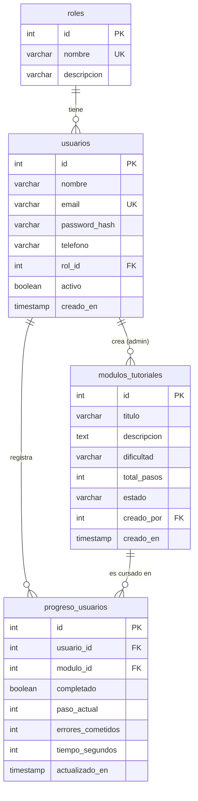

# App de Alfabetización Digital Ciudadana

## Integrantes del Equipo
* [Alexis Parra](https://github.com/AlexisEstebanParraS)
* [Fernando Pacheco](https://github.com/F3rsj)
* [Gabriel Díaz](https://github.com/Gabread)
* [Israel Pérez](https://github.com/Y63431)

---
# Municipio Fácil - Backend API

API REST del proyecto **Municipio Fácil**, desarrollado para la asignatura Ingeniería Web y Móvil.

## Descripción General

API que gestiona usuarios, módulos de práctica de trámites municipales y el progreso de cada ciudadano, y entrega métricas al administrador.

* **Ciudadano:** realiza los módulos y ve solo su progreso.
* **Administrador:** gestiona módulos y usuarios y revisa métricas.

## Problema y Objetivos

**Problema:** muchas personas, en especial adultos mayores, no saben usar los portales municipales y dependen de la atención presencial.

**Objetivo general:** entregar un servidor seguro para una plataforma de práctica de trámites con seguimiento del aprendizaje.

**Objetivos específicos:**
* Registro y autenticación con JWT y bcrypt.
* Permisos distintos para ciudadano y administrador.
* CRUD de módulos.
* Registro de progreso, errores y tiempo.
* Métricas de error y abandono.

## Funcionalidades Principales

* Registro e inicio de sesión con validación.
* Catálogo de módulos con filtros por estado y dificultad.
* CRUD de módulos (administrador).
* Progreso por usuario: paso actual, errores, tiempo y completado.
* Gestión de usuarios y métricas (administrador).
* Perfil del usuario.
* Correo de bienvenida (Resend).

## Tecnologías y Herramientas

* **Node.js** 18+ y **Express** 5
* **PostgreSQL** con `pg`
* **jsonwebtoken** y **bcrypt**
* **cors**, **helmet** y **express-rate-limit**
* **dotenv**
* **Insomnia**
* **Docker** y **Docker Compose**

## Requisitos Previos

* **Node.js** (v18 o superior)
* **PostgreSQL** (servicio activo)
* **Git**

## Instalación y Configuración

### 1. Clonar el repositorio

```
git clone https://github.com/Y63431/Alfabetizacion-Web.git
cd Alfabetizacion-Web
git checkout backend
```

### 2. Instalar dependencias

```
npm install
```

### 3. Configurar variables de entorno

```
cp .env.example .env
```

| Variable | Descripción |
|---|---|
| `PORT` | Puerto del servidor (`3000`) |
| `DB_HOST`, `DB_PORT`, `DB_USER`, `DB_PASSWORD`, `DB_NAME` | Conexión a PostgreSQL |
| `JWT_SECRET` | Clave para firmar tokens (obligatoria) |
| `JWT_EXPIRES_IN` | Duración del token (`2h`) |
| `FRONTEND_ORIGIN` | Origen permitido por CORS |
| `RESEND_API_KEY`, `CORREO_REMITENTE` | Correo de bienvenida (opcional) |
| `ADMIN_NOMBRE`, `ADMIN_EMAIL`, `ADMIN_PASSWORD` | Datos del primer administrador |

### 4. Inicializar la Base de Datos

```
psql -U postgres -f database.sql
```

### 5. Crear el administrador

```
npm run crear-admin
```

### 6. Iniciar el servidor

```
npm run dev
```

El servidor estará escuchando peticiones en `http://localhost:3000/api`.

## Flujo de Trabajo Simultáneo (Frontend + Backend)

1. **Crea el Worktree para el Frontend:**

   ```
   git worktree add ../frontend-app frontend
   ```

2. **Levanta el servidor (Backend):**

   ```
   npm run dev
   ```

3. **Levanta la interfaz (Frontend):**

   ```
   cd ../frontend-app
   npm install
   npm run dev
   ```

## Base de Datos



* `usuarios.email` y `roles.nombre` son únicos.
* `dificultad`: `Facil`, `Media` o `Alta`. `estado`: `Habilitado`, `Borrador` o `Deshabilitado`.
* `UNIQUE (usuario_id, modulo_id)` en `progreso_usuarios`.
* `ON DELETE CASCADE` en el progreso, `RESTRICT` en `usuarios.rol_id` y `SET NULL` en `creado_por`.

## Endpoints de la API

URL base: `http://localhost:3000/api`. Las rutas protegidas usan `Authorization: Bearer <TOKEN>`.

```json
{ "ok": true, "message": "Módulo creado", "data": { } }
{ "ok": false, "error": { "mensaje": "Datos inválidos", "detalles": ["titulo es obligatorio"] } }
```

| Método | Ruta | Acceso | Descripción |
|---|---|---|---|
| GET | `/health` | Público | Estado del servidor y de la base de datos |
| POST | `/auth/registro` | Público | Registrar ciudadano |
| POST | `/auth/login` | Público | Iniciar sesión |
| GET | `/modulos` | Autenticado | Listar módulos (`estado`, `dificultad`, `page`, `limit`) |
| GET | `/modulos/:id` | Autenticado | Obtener un módulo |
| POST | `/modulos` | Admin | Crear módulo |
| PUT | `/modulos/:id` | Admin | Reemplazar módulo |
| PATCH | `/modulos/:id` | Admin | Modificar campos de un módulo |
| DELETE | `/modulos/:id` | Admin | Eliminar módulo |
| GET | `/progreso` | Autenticado | Listar progreso (propio, o todos si es admin) |
| GET | `/progreso/:id` | Dueño o admin | Obtener un progreso |
| POST | `/progreso` | Autenticado | Iniciar un módulo |
| PATCH | `/progreso/:id` | Dueño o admin | Actualizar avance |
| DELETE | `/progreso/:id` | Dueño o admin | Eliminar progreso |
| GET | `/admin/usuarios` | Admin | Listar usuarios (`page`, `limit`) |
| PATCH | `/admin/usuarios/:id` | Admin | Activar/desactivar cuenta o cambiar rol |
| GET | `/admin/metricas` | Admin | Métricas de aprendizaje |
| GET | `/usuarios/me` | Autenticado | Ver mi perfil |
| PUT | `/usuarios/me` | Autenticado | Actualizar nombre y teléfono |

| Código | Significado |
|---|---|
| 200 / 201 | Operación exitosa / recurso creado |
| 400 | Datos inválidos o campos no permitidos |
| 401 | Sin token, token inválido o credenciales incorrectas |
| 403 | Sin permiso |
| 404 | No existe |
| 409 | Valor duplicado |
| 429 | Demasiados intentos de inicio de sesión |
| 500 | Error interno |
| 503 | La base de datos no responde |

## Autenticación y Roles

* El token JWT contiene `{ id, email, rol_id }` y expira según `JWT_EXPIRES_IN`.
* `verificarToken` valida el token y `esAdmin` exige `rol_id = 2`.
* Todo registro crea un ciudadano; el administrador se crea con `npm run crear-admin`.

| Recurso | Sin token | Ciudadano | Admin |
|---|---|---|---|
| Registro / login | Sí | Sí | Sí |
| Ver módulos | No | Solo `Habilitado` | Todos |
| Crear, editar, borrar módulos | No | No | Sí |
| Progreso | No | Solo el suyo | Todos |
| Usuarios y métricas | No | No | Sí |
| Mi perfil | No | Sí | Sí |

## Seguridad

| Medida | Implementación |
|---|---|
| Contraseñas | bcrypt (10 rondas); el hash no se devuelve |
| Inyección SQL | Consultas parametrizadas (`$1, $2`) |
| Validación | Solo campos permitidos; tipos y largos revisados |
| XSS | Nombre, título y descripción rechazan `<` y `>` |
| Credenciales | Secretos en `.env`, fuera del repositorio |
| Autenticación | JWT con expiración |
| Autorización | Por rol y por dueño del progreso |
| CORS | Solo `FRONTEND_ORIGIN` |
| Fuerza bruta | 10 intentos de login por IP cada 15 minutos |
| Cabeceras | `helmet` |

## Servicio Externo

Correo de bienvenida al registrarse, enviado con la API de [Resend](https://resend.com) (`src/services/correo_service.js`). Si `RESEND_API_KEY` está vacía no se envía.

## Despliegue con Docker

`docker-compose.yml` levanta **db** (PostgreSQL 16), **api** (este backend) y **web** (frontend con Nginx):

```
git worktree add ../frontend-app frontend
docker compose up --build -d
docker compose exec api npm run crear-admin
```

| Servicio | URL |
|---|---|
| Frontend | http://localhost:8080 |
| API | http://localhost:3000/api |

## Pruebas de Endpoints con Insomnia

Colección: [`docs/insomnia_collection.json`](docs/insomnia_collection.json) (35 peticiones). Se importa en Insomnia con *Import*.

| # | Prueba | Resultado |
|---|---|---|
| 1 | Registro válido | 201 + token |
| 2 | Email repetido | 409 |
| 3 | Contraseña débil | 400 |
| 4 | HTML en el nombre | 400 |
| 5 | Login correcto | 200 + token |
| 6 | Contraseña incorrecta | 401 |
| 7 | Más de 10 logins en 15 min | 429 |
| 8 | `GET /modulos` sin token | 401 |
| 9 | `GET /modulos` como ciudadano | 200, solo `Habilitado` |
| 10 | `GET /modulos?estado=Raro` | 400 |
| 11 | `POST /modulos` como ciudadano | 403 |
| 12 | `POST /modulos` como admin | 201 |
| 13 | `DELETE /modulos/:id` como admin | 200 |
| 14 | `POST /progreso` | 201 |
| 15 | `POST /progreso` con `usuario_id` | 400 |
| 16 | `POST /progreso` repetido | 409 |
| 17 | `paso_actual` mayor al total | 400 |
| 18 | Progreso de otro ciudadano | 403 |
| 19 | `GET /admin/usuarios` como ciudadano | 403 |
| 20 | Cuenta desactivada intenta login | 401 |
| 21 | `PUT /usuarios/me` con datos inválidos | 400 |


